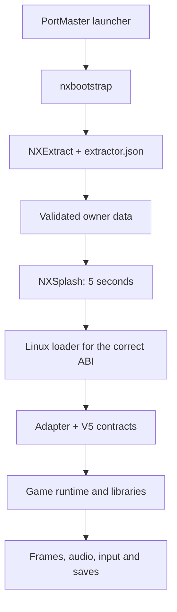

# NextOS 游戏移植指南

> **语言说明**：本指南为基于本集合内容的原创梳理，当前**仅有中文版**，尚未提供 English / Português 译文。项目对双语编辑文档的约定见 [AGENTS.zh-CN.md](AGENTS.zh-CN.md)。

本指南把分布在 `docs/zh/` 中的二十篇专题文档串成一条**可执行的主线**：从一个 Android 游戏构建出发，得到一个符合 V5 契约、带证据、可在 ARM Linux 掌机上运行的 NextOS 移植。

本指南是**索引与流程骨架**，不是替代品。凡涉及具体判定标准，一律以各专题文档与生成器 schema 为准。文中所有命令、路径与脚本均取自本集合，未虚构工具。

---

## 目录

- [第一部分：认知前提](#第一部分认知前提)
- [第二部分：环境与首次验证](#第二部分环境与首次验证)
- [第三部分：资产清查与 runtime 判定](#第三部分资产清查与-runtime-判定)
- [第四部分：锁定来源与资料出处](#第四部分锁定来源与资料出处)
- [第五部分：契约与 shims](#第五部分契约与-shims)
- [第六部分：交叉编译与 ELF 审计](#第六部分交叉编译与-elf-审计)
- [第七部分：编写 adapter](#第七部分编写-adapter)
- [第八部分：NXExtract 与干净安装](#第八部分nxextract-与干净安装)
- [第九部分：打包、验证与交付](#第九部分打包验证与交付)
- [第十部分：故障排查速查](#第十部分故障排查速查)
- [附录：命令速查、交付清单与实机显示适配](#附录命令速查交付清单与实机显示适配)

---

## 第一部分：认知前提

### 1.1 NextOS 会做什么，不会做什么

框架负责**探测环境、安装数据、加载库、桥接兼容性、交付产物**。它不会把任何 APK 自动变成 Linux 程序。每个游戏的 adapter 才是把通用契约连接到真实引擎的那一层。

三条必须刻在脑子里的事实：

1. **`nxandroid` 不是 JVM。** 它是按构建区分的 JNI 类/方法与生命周期集成点。一个被要求却缺失的方法，仍属于 adapter 的任务。
2. **找到符号名不等于证明兼容。** 正确的 shim 必须同时保留签名、调用约定、内存布局、所有权、生命周期、错误与回调。
3. **「所有导入都已解析」只衡量解析。** 它不衡量玩法、并发、存档或图形保真度。

### 1.2 四组彼此独立的决策

这四件事必须分别判断，不能互相推导：

| 维度 | 说明 |
| --- | --- |
| ABI | `arm64-v8a` 描述的是 **Android 客机**；AArch64 Linux 主机走 glibc。Bionic 与 glibc 并非在所有布局和契约上都一致 |
| 操作系统 | Android 客机库 ≠ Linux 原生库。Linux 交叉编译器构建的是加载器，NDK 构建的是 Android 示例，两者不可混用 |
| 渲染器 | 被转译的逻辑 GLES3 渲染器，只能对**真正实现了**的操作使用物理 GLES2。在 Mali-450 上必须面向真实 GLES2 |
| 引擎 | 实际确定的 engine family 决定所需实现的 JNI、回调与初始化顺序 |

### 1.3 执行链路



`NXExtract` 在游戏启动**之前**准备好原作者数据；`NXSplash` 是另一块更晚出现的画面，用于展示 NEXT OS / RETRO ELITE 五秒钟。两者都保留各自的规范接口，**不得修改**。

### 1.4 不可逾越的红线

以下条目来自 [AGENTS.zh-CN.md](AGENTS.zh-CN.md)，违反其中任何一条都会导致移植无法发布：

- **绝不要**提交或上传 APK/IPA/OBB、专有游戏库、资源、存档、内存转储或私有日志；也不要把它们作为 CI 产物上传。
- 只使用**所有者提供**的游戏输入。旧的主机地址永远不构成建立新连接的授权；设备访问必须使用当前任务提供的地址。
- 把 `framework/`、`suportando_outros_devices/extrator-universal/` 与既有 `ports/*/upstream/` 视为**冻结的参考来源**，开发新游戏时不要修改它们。
- 每个新游戏都创建在 `work/ports/<port-id>/` 下或独立仓库中。这个被忽略的工作区不属于已发布的合集。
- 未知的必需导入**必须**产出精确诊断，绝不能编造成功；不允许用笼统的 `return 0` 掩盖问题。
- 活动音频、一个 PID、上下文创建成功或 `exit 0` **都不能**证明图形正常。
- 不要把 iOS/iPadOS 的移植、研究、加载器或示例加入本集合。
- 对本项目的署名仅写作 **NextOS**，链接指向 `https://github.com/NextOs-Ports`。保留第三方法律声明，切勿在提交中添加 AI 署名或 co-author 尾部信息。

### 1.5 数据分类

新的移植必须严格区分这四类对象。混淆它们是绝大多数灾难性错误的根源：

| 类别 | 位置 | 可否入库 |
| --- | --- | --- |
| 原始源码快照 | `ports/*/upstream/`、`SOURCE-MAP.json` | 已冻结，不改 |
| 准备工具与配方 | `prepare_*.py`、`extractor.json`、`build.py` | 可，须带 pin |
| 可再分发的运行时 | `framework/` 各 nx* 组件 | 遵循 V5 pin |
| 原作者私有数据 | APK、OBB、资源、存档 | **绝不可入库** |

---

## 第二部分：环境与首次验证

### 2.1 依赖清单

使用 Linux，并安装：Git、Python **3.11+**、CMake **3.20+**（C 项目可接受 3.16）、C99 编译器、Make 或 Ninja、ELF 工具 `readelf`，以及读取二进制 Android 清单所需的 `aapt`。

在 Windows 上，请在 Linux 环境中运行这些命令；掌机 GPU 测试仍是独立步骤。

```sh
git --version
python3 --version
cmake --version
cc --version
readelf --version
```

### 2.2 克隆并校验集合

在仓库处于私有状态期间，你的账户需要访问权限。请使用你惯常的认证方式，**不要把令牌粘贴进脚本或文档**。

```sh
git clone https://github.com/NextOs-Ports/nextos-framework.git
cd nextos-framework
git rev-parse HEAD
python3 publication/verify.py
```

记录下集合的 commit。校验器会对照各清单检查导入的文件，并查找被识别的禁止格式与模式。**哈希不匹配时必须找回正确的来源，不要为了消除报错就更新清单。**

> 注意：克隆必须包含被固定的 commit，不能用 `--depth 1` 的浅克隆——`--depth 1` 可能遗漏 pin 所需的对象。

### 2.3 跑通主机示例（不可跳过）

```sh
cmake -S examples/shims-reference -B work/host -DCMAKE_BUILD_TYPE=Release
cmake --build work/host --parallel 2
ctest --test-dir work/host --output-on-failure
```

预期结果：`explicit-shim-contracts` 测试通过。该示例演示了带类型的解析、未知导入的错误、按线程的 `errno` 与有界缓冲区操作。

**这一步的意义是把示例本身与基础工具的错误隔离开。** 主机测试通过只能证明该示例的行为，它还没有加载过 Android 库、没有在 Mali 上渲染过图像，也没有运行过任何游戏。

### 2.4 公开 SDK（推荐路径）

SDK 提供了一套经过验证的 AArch64/ARMv7 低 glibc 构建配方，仅使用公共源码，不依赖任何 NextOS 私有镜像。

```sh
mkdir -p work
docker build --platform linux/amd64 -t nextos-public-sdk:1 toolchains/sdk
docker image inspect nextos-public-sdk:1 --format '{{.Id}}'
```

构建需要网络以拉取公共依赖；后续运行使用 `--network none`。请记录镜像 ID。首次构建需编译工具，耗时较长，此后 Docker 会复用镜像层。

SDK 内的 Git 是为本地操作编译的，**不含 HTTP 传输**：请在主机端完成源码克隆，之后再挂载 checkout。详见 [toolchains/sdk/zh/README.md](toolchains/sdk/zh/README.md)。

---

## 第三部分：资产清查与 runtime 判定

### 3.1 执行清单登记

清单登记工具会生成技术信息，但**不执行访客代码**，并在其 JSON 中排除外部 APK 文件名与计算机路径。

```sh
python3 tools/inventory_apk.py /private/owner-input/base.apk \
  /private/owner-input/config.arm64_v8a.apk \
  --output work/inventory.json
python3 tools/find_reference.py --engine Unity --abi arm64-v8a --renderer GLES2
```

输出必须是**新文件**。若要在容器中使用这些工具，需将输入以只读方式显式挂载到 `/private/owner-input`，同时挂载集合目录与 `work/`。**不要将输入发送给 CI 或外部服务。**

清单登记同样能识别 GameMaker（`libyoyo.so`）、Ren'Py（`librenpython.so`）以及 Haxe/hxcpp/Lime（同一 ABI 中的成对库）等提示。它检查被检视的原生库名称，而不会依据名称相似的资源文件进行分类。**提示是按 APK 逐个给出的：请比对分包报告，不要把缺失当作不可能。**

### 3.2 工具的两类强制限制

| 被拒绝的输入 | 阈值 |
| --- | --- |
| 单个容器成员 | > 512 MiB |
| 所有 APK 合计解压 | > 8 GiB |
| Android 清单 | > 2 MiB（解压前即检查） |
| — | 不安全/非规范路径、冲突、符号链接、加密成员、重复的 base/split 身份 |

嵌套的 APKM/APKS/XAPK **不会**自动展开，请在一个私有区域内于本地准备好该集合。该工具不保证分包完整，也不负责格式转换。

### 3.3 解读字段

报告包含：包名/分包名、可用时的版本、容器大小/哈希、ABI 库、哈希、带类型/绑定/版本的导入、依赖与引擎提示。缺失的版本保持为 `null`；**引擎识别仍属假设**。

`arm64-v8a` 偏好只适用于**包含该 ABI 的那个 APK**，并要求该目录下每一个库都具备一致的 64 位 ELF class 与 AArch64 machine。`abi_consistent` 记录这项检查；头部不一致会产生**明确的阻塞项**，无法据此选择 AArch64。

请务必检查整个分包集合——资源分包并不能证明架构正确。ARMv7 构建需要额外复查 softfp 边界。

在选择 V5 nxloader 之前，以下重定位/FEATURE 需要特别留意：
`TLS`、`TLSDESC`、`IFUNC`、`IRELATIVE`、`RELR`、`TEXTREL`、`RPATH/RUNPATH`、打包的 Android 重定位。

### 3.4 八条 Android 技术路线

本路线始终从所有者提供的 **Android** 构建出发，目标为 Linux ARM。选错路线会导致大量无用功。

| `--runtime` 族 | Android 输入线索 | 选定公开参考 | 专题指南 |
| --- | --- | --- | --- |
| `unity` | `libunity.so`；Mono 或 IL2CPP/metadata | 按版本区分的具体案例 | [移植 Unity](portando_unity/README.zh-CN.md) |
| `mono-android` | Mono/.NET Android、程序集与 Java bootstrap | Stardew Valley、ScourgeBringer、Blossom Tales；SOR4 用于宿主适配 | [Mono Android](docs/zh/MONO-ANDROID.md) |
| `godot` | Godot 库、PCK/导出及匹配版本 | Tearscape | [Godot](docs/zh/GODOT.md) |
| `cocos2d-x` | JNI/Cocos2d-x、调度器与资源 | Chrono Trigger、Geometry Dash | [Cocos2d-x](docs/zh/COCOS2D-X.md) |
| `gamemaker` | `libyoyo.so`、运行器及其所消费的文件 | Forager | [GameMaker Android](docs/zh/GAMEMAKER-ANDROID.md) |
| `renpy` | `librenpython.so`、Python/Ren'Py bootstrap 与资源 | Summertime Saga | [Ren'Py Android](docs/zh/RENPY-ANDROID.md) |
| `haxe-lime` | 同 ABI 中 `liblime.so` 与 `libApplicationMain.so`；需确认 hxcpp | Tightrope Theatre | [Haxe/hxcpp/Lime](docs/zh/HAXE-LIME-ANDROID.md) |
| `native-android` | C/C++ 库、JNI、NativeActivity 或 Android SDL | Action Squad、KOTOR、Angry Birds、RCRDX | [Android C/C++](docs/zh/NATIVE-ANDROID.md) |

```sh
python3 tools/find_reference.py --runtime gamemaker
python3 tools/find_reference.py --runtime renpy --abi arm64-v8a
python3 tools/find_reference.py --runtime native-android --abi arm64-v8a
```

检索默认返回含 **Android 来源**的档案（38 个 Android 来源档案，目录共 40 个来源档案）。`--engine` 按名称检索；`--runtime` 用于选择族，**即使引擎名称仍为 `unknown` 也适用**。ABI 与渲染器属于附加过滤条件，绝不能替代证据。

**结果为空时应着手契约调查，而不是证明其不可能。** `--platform all` 表示显式检索完整历史目录，超出本路线范围。

### 3.5 三条易犯的误判

1. `liblime.so` 单独存在无法判定为 hxcpp 应用；缺少已知特征也不能判定为 C/C++。
2. MonoGame/FNA 仅当它属于被检查的该 Android 构建时才适用。它**不提供**桌面游戏通道。
3. 以 Java/Kotlin 为主的 APK 需要 runtime 层面的调查；这些指南并未演示通用的 ART 支持。

---

## 第四部分：锁定来源与资料出处

### 4.1 物化已冻结的选型

```sh
python3 tools/pin_collection.py --destination work/my-collection-pin
```

该辅助脚本会对 `c5a5c827ed1918572a7cc01fc5a1740341b7a92d` 打 pin（该哈希已在本集合中发布），**不使用会移动的 `HEAD`**。结果是包含 commits、哈希与收据的 **15 个组件**的组合。原始出处仍为 V5 `657fb65a23b5c3b20040e76307b27e6470b1d17c`。

### 4.2 理解两棵树

| 树 | 用途 | 约束 |
| --- | --- | --- |
| `source/` | 完全遵循 V5 `framework_pin.py` 契约，nxloader 编译使用该树 | **不要在 `source/` 内新增目录**，会使校验失效 |
| `tool-source/` | 完整选定导出，按 pinned manifest 逐文件校验 | 生成过程使用它，因还需 `framework/contracts/apkcompat` |

`TOOL-SOURCE.json` 记录第二棵树的文件；没有任何规范组件被修改。被省略的私有测试保持省略。

### 4.3 找回被省略的公开来源

```sh
python3 tools/recover_reference.py fp2-nextos --path build_universal.sh \
  --destination work/recovered-fp2
```

该文件在目录清单所对应的 commit 上取回并记录哈希，且**仅写入 `work/` 之下**。若它已被包含在选型中，下载内容必须与 manifest 的 SHA-256 一致。文件本身与其出处记录都必须是新的，并使用 `0600` 权限。该命令**不会执行**该脚本，也不会修改 `ports/*/upstream/`。

> FP2 的公开仓库中就有 `build_universal.sh`，尽管选型时将其省略了。Chrono 的构建需要一个本地镜像和一个被排除的 TTF——新 SDK 并不会自动使该历史脚本变得可移植。

### 4.4 阅读参考的正确姿势

对每个候选参考，打开其 `SOURCE-MAP.json` 并检查：

- **commit 是否明确**（历史 pin 并不构成 V5 迁移）
- 纳入/排除了哪些文件
- 各文件的许可声明 —— 特别是 GM 类的 loader 常派生自 GPL-2.0-only 项目，而本集合含 GPL-3.0-only 代码，**必须明确这条边界**
- 其证据是否指向**同一份产物**

 > **反面参考警告**：Tightrope Theatre 的快照标明为 `1.0.5-test.1`，其物理验收仍待完成。处于测试中的行为属于**反面参考**，不是可以照抄的已批准实现。请查阅 [pins 与来源](docs/zh/PINS-AND-SOURCES.md)。

**不要为了接受另一个库而移除哈希。** 也不要因为两个游戏都用 C# 就照搬某一游戏的 bootstrap。

---

## 第五部分：契约与 shims

### 5.1 三层逼近：先读示例，再列清单，最后选择

**第一步 — 研究可执行示例。** [examples/shims-reference](examples/zh/shims-reference/README.md) 中，`shims.h` 定义签名与函数指针联合，`shims.c` 只注册显式的实现，`main.c` 验证这些契约。

| 契约 | 演示的行为 | 限制 |
| --- | --- | --- |
| `__errno` | 返回调用线程的 `errno` 地址 | 不能覆盖全部 Bionic TLS |
| `__android_log_write` | 输出到 stderr 的诊断；成功返回 1，失败返回负错误码 | 未实现 Android 过滤/logd |
| `nx_demo_property` | 只提供 `demo.name`，且带显式容量 | 不是 `__system_property_get` |
| Resolver | 符号名缺失或枚举签名错误时返回 NULL | 枚举无法推断 ELF 的 ABI |

**第二步 — 盘点导入。** 在私有区域准备好库之后：

```sh
readelf -Ws <lib>   # 符号
readelf -d  <lib>   # 依赖
readelf -r  <lib>   # 重定位
```

区分必需的未定义符号、弱符号、对象与 TLS。**务必**检查在运行时通过 `dlsym`、`eglGetProcAddress` 和 JNI 获得的导入——静态列表可能不包含它们。

**第三步 — 填契约工作表。** 这张表属于新的移植，每一行应该包含：

`名称 · 符号版本 · 类型 · ABI · 签名 · 调用方 · 预期结果/错误 · 缓冲区所有者 · 线程 · 选定的实现 · 来源/哈希/授权 · 测试 · 限制`

### 5.2 适配类型决策表

| 情形 | 决定 |
| --- | --- |
| ABI 与语义已被证明完全相同 | 以正确的类型转发给主机 |
| 布局/枚举/错误不同 | 显式转换输入与输出 |
| 异步回调或有状态对象 | 实现生命周期与同步 |
| 缺失的可选服务 | 返回契约所定义的「无」，并为该路径提供证据 |
| 未知的必需服务 | **带精确诊断信息失败**，并在验收前实现 |

**绝对禁止**：盲目强制转换 `pthread_mutex_t`、`FILE`、信号结构、`dirent` 或 JNI 对象；强制把所有互斥量变成递归的；用受管指针/JNI 句柄替换原生指针。

像 `__stack_chk_guard` 这样的**对象不能变成函数地址**。教学用的 resolver 不做重定位——在与真实 loader 集成之前，必须从库/引擎的契约中识别 ELF 符号类型与签名。

### 5.3 JNI 规则

按**精确签名**注册类、方法和字段，保留局部/全局引用、异常、字符串转换与线程附加。

> `JNIEnv` 属于它所在的线程。**不要在多个 worker 之间共享任意一个指针** —— 即使指针非 null，跨线程共享也是错误的。

参考：[官方 JNI 指南](https://developer.android.com/ndk/guides/jni-tips)

### 5.4 覆盖度分类

把每个契约归类为以下四种之一，并记录实际使用的数据资料/ABI：

`implemented-tested` · `adapter-required` · `optional-absent` · `unsupported`

覆盖面的扩大必须围绕目录中已有的族系与重复出现的契约推进。当前示例只教授结构，**它不是一个近乎完整的 Android shim**。

寻找更完整实现的起点：

| 边界 | 起始来源 |
| --- | --- |
| ELF 与重定位 | [nxloader](framework/nxloader/README.md) |
| Android/生命周期 | [nxandroid](framework/nxandroid/README.md) |
| 上下文/present | [nxgl](framework/nxgl/README.md) |
| 混音器/输出 | [nxaudio](framework/nxaudio/README.md) |
| 输入与上下文 | [nxinput](framework/nxinput/README.md) |
| Unity | [公开案例与诊断](portando_unity/README.zh-CN.md) |

---

## 第六部分：交叉编译与 ELF 审计

### 6.1 三种构建必须分清

| 产物 | 构建环境 | 运行环境 |
| --- | --- | --- |
| C 契约测试 | 计算机自身的原生编译器 | Linux 主机 |
| `<port-id>-nextos` 加载器/适配器 | Linux 交叉编译器 + Linux sysroot | 设备的 ARM Linux |
| 原生 Android 库示例 | NDK + Bionic sysroot | Android 或兼容的 Android 加载器 |

**商业库已在 APK 内编译完成；创建移植并不会重新编译它。**

> 没有任何编译选项能把 ELF32 变成 ELF64。Android ARMv7 使用 `softfp` 传递浮点参数，而 Linux ARMHF 接口可能使用 VFP 寄存器。

### 6.2 构建 AArch64

```sh
export NEXTOS_AARCH64_CC=/opt/nextos-toolchain/bin/aarch64-linux-gnu-gcc
export NEXTOS_SYSROOT=/opt/nextos-sysroots/aarch64
test -x "$NEXTOS_AARCH64_CC"
test -d "$NEXTOS_SYSROOT"
"$NEXTOS_AARCH64_CC" --version
"$NEXTOS_AARCH64_CC" -dumachine
"$NEXTOS_AARCH64_CC" --sysroot="$NEXTOS_SYSROOT" -print-sysroot

cmake -S examples/shims-reference -B work/aarch64 \
  -DCMAKE_TOOLCHAIN_FILE="$PWD/toolchains/linux-aarch64.cmake" \
  -DCMAKE_BUILD_TYPE=Release
cmake --build work/aarch64 --parallel 2
```

使用 SDK 容器时，`NEXTOS_SYSROOT=/` 描述的是 **multiarch 容器的根** —— 由交叉编译器选择其 ARM 库，**并不意味着**使用宿主机的根目录，更不能把设备卡片复制一份当作 SDK。

**更换 ABI、编译器或 sysroot 时，请使用全新的构建目录。** CMake 缓存可能仍保留旧的编译器。不要把 ARM 头文件与 x86 库混用，也不要内嵌私有 SDL 来绕开检测失败。

### 6.3 执行前 ELF 审计

```sh
readelf -h work/aarch64/shim-reference-nextos
readelf -l work/aarch64/shim-reference-nextos
readelf -d work/aarch64/shim-reference-nextos
readelf --version-info work/aarch64/shim-reference-nextos
sha256sum work/aarch64/shim-reference-nextos
```

| 输出 | 检查项 |
| --- | --- |
| `-h` | ELF64 与 `Machine: AArch64`；**文件名不能证明架构** |
| `-l` | 若存在 `INTERP`，目标机上是否有可用的 Linux 解释器 |
| `-d` | 每一个 `NEEDED` 依赖以及任何 RPATH/RUNPATH |
| `--version-info` | 所需的 GLIBC 版本；C++ 还需复核 GLIBCXX/CXXABI |

**对随附交付的每一个 Linux ELF 都要审计**，包括辅助程序与库。

> **`GLIBC_2.30` 是发布上限**，并非兼容性的充分证明：架构、内核、SDL、EGL 与音频仍然相关。使用较新的 GCC 和库，并不会仅仅因为改了清单文本就产生更旧的兼容性。

不要用 `ldd` 通过执行来分析未知的 Android ELF；应先检查它的静态信息。也不要把 ARM ELF 当作原生程序在 x86 上运行。

### 6.4 ARMv7 的额外负担

```sh
export NEXTOS_ARMV7_CC=/opt/nextos-toolchain/bin/arm-linux-gnueabihf-gcc
export NEXTOS_SYSROOT=/opt/nextos-sysroots/armhf
cmake -S examples/shims-reference -B work/armv7 \
  -DCMAKE_TOOLCHAIN_FILE="$PWD/toolchains/linux-armv7.cmake" \
  -DCMAKE_BUILD_TYPE=Release
cmake --build work/armv7 --parallel 2
readelf -h -A work/armv7/shim-reference-nextos
```

ARMHF 加载器与 Android ARMv7 客机可能共享同一颗 CPU，却并**不共享每一个函数的 ABI**。在适配带 `float`/`double` 的回调之前，请先阅读 `framework/nxloader/include/nxloader_softfp.h`；结构体布局与 `pthread` 同样需要按 ABI 复核。

### 6.5 交付中 QEMU 的定位

交叉编译期间本项目不注册 CTest 测试——**「no tests found」并不代表 ARM 通过了**。QEMU 执行（在明确准备的情况下）必须**如实报告为 CPU 仿真**，不能用来认可界面或实际图形效果。

---

## 第七部分：编写 adapter

### 7.1 组件职责全景

| 领域 | 组件 | 移植职责 |
| --- | --- | --- |
| 入口与执行 | `nxbootstrap` | 声明正确的文件、ABI 与适配器 |
| 环境 | `nxcompat` | 依据实测能力与目标上限做决策 |
| 加载 | `nxloader`、`nxabi` | 库、原生顺序、导入与 ABI 桥接 |
| Android | `nxandroid` | 按构建区分的 JNI 类/方法与生命周期 |
| 图形 | `nxgl` | 引擎渲染、着色器、纹理与真实上下文的 present |
| 声音 | `nxaudio` | 游戏所用的混音器与 OpenSL/AudioTrack/AAudio 回调 |
| 输入 | `nxinput` | 真实的引擎动作与消费者；菜单/玩法 |
| 数据 | NXExtract | 身份、提取、钩子与校验配方 |
| 诊断 | `nxobs`、`nxdoctor`、`nxledger` | 执行证据与范围恰当的结论 |
| 组合 | `nxgenerator`、`nxrelease` | 清单、pin、对应源码与可验证的包 |

**这些组件是集成点，而非每个 Android 服务的完整实现。**

### 7.2 原生顺序（务必按引擎调查所得执行）

```
map → 重定位 → 导入 → 保护 → 构造函数 → JNI_OnLoad
    → create → resume → 帧/音频/输入 → pause → save → destroy
```

确切顺序来自**被调查的引擎**，而不是一份通用的函数名清单。以 Cocos2d-x 的 Chrono 配置为例：

> 加载并初始化 C++ 依赖 → 加载/重定位游戏库 → 安装经过验证的挂钩 → **只执行一次**构造函数 → 调用 `JNI_OnLoad` → 发布上下文/资源 → `nativeInit` → resume → 事件/渲染循环 → pause/存档与退出

**不要**：在提供所需上下文之前调用 `nativeInit`；执行两次构造函数；通过直接调用某个房间/关卡函数来绕过初始化。

### 7.3 八条边界的验证清单

| 边界 | 需要验证的实现 |
| --- | --- |
| 资源 | 正确的路径/大小写查找、压缩文件、读取/定位/关闭 |
| JNI | 真实的类、签名、字符串/数组与回调；对缺失项给出明确的报错 |
| 文本 | 字体、字号、对齐、Unicode、位图的跨度/格式与 alpha |
| GLES | 渲染线程上使用正确的上下文，状态管理与单次 present |
| 音频 | OpenSL 对象/vtable、BufferQueue 与缓冲区生命周期 |
| 输入 | 每个动作/上下文只保留一条路径，并确保有真实的释放 |
| 存档 | 持久化路径与事务性发布标记 |
| 退出 | 不创建第二个窗口或进程所有者 |

### 7.4 建议的工程结构

在**新的**移植仓库中维护以下产物（名称仅为组织性建议，生成器的实际 schema 仍然具有权威性）：

```
docs/inventory.md       # 清单登记结果（去私有信息）
docs/contracts.md       # 契约工作表
src/                    # adapter 源码
recipes/                # 构建与提取配方
docs/validation.md      # 测试记录与证据
```

### 7.5 AI 协作的正确姿势

若由 AI 助手承担实现，请给出**具体任务**而非模糊目标，并把未知字段明确定义为调查任务。核心要求：

- 复用既有的 [清单登记](#31-执行清单登记)、[pins](docs/zh/PINS-AND-SOURCES.md) 与 [诊断实验室](docs/zh/DIAGNOSTIC-LAB.md) 工具，**不要在发明新工具上浪费第一步**。
- 一次只修一处边界，保留原生顺序。
- 不要编造偏移量、签名、支持范围、许可或「缺失但已成功」的 API。
- 每次运行都记录检查点：改了什么、执行的命令、结果、剩余工作、下一个独立步骤。恢复工作时读取该检查点并比对文件，而不是重新发现已被证明的修正。

详见 [AI 移植](docs/zh/AI-PORTING.md)。

---

## 第八部分：NXExtract 与干净安装

### 8.1 BYO-data 的基本假设

一个 BYO-data 的移植分发的是：**被允许的代码/运行时 + 完整的框架 + 一份配方 + 带规范图形界面的 NXExtract**。数据来自所有者提供的兼容副本。**移植本身不含游戏数据。**

### 8.2 定义输入标识

记录游戏名称/版本、包 ID、ABI，以及被测试参考 APK 的**大小与 SHA-256**。识别关键库、元数据、bundle 与附属文件。分卷输入在测试之前必须完整。

> 当容器内的兼容内容保持不变时，**不要**仅仅因为容器的签名、成员顺序或外部文件名发生变化就拒绝它。但配方兼容性仍须校验包 ID、版本契约、ABI、结构与关键载荷。

### 8.3 编写提取配方

请从[规范的最小示例](suportando_outros_devices/extrator-universal/examples/recipe-minimal.json)与 `nxextract.py` 中的 `Recipe` 类读起。最小示例只是结构性的，真实游戏所需的标识还需要额外校验。

| 字段/区域 | 需要记录的决定 |
| --- | --- |
| `id`、`version`、`title` | 稳定的配方标识与修订 |
| `abi_order` | **仅写已实现的 ABI**；AArch64 排在最前 |
| `input.search_dirs` | `gamedata` 排在首位，遵循生成器的策略 |
| `extract` | 内部路径、目标位置以及按载荷的校验 |
| Hooks | 必需的转换、来源、工具与哈希 |
| `validate` | 运行时将消费的数据的最终检查 |
| `commit` 与 marker | 事务性发布与安装标识 |

**不要凭这张表臆造键名**——请使用所固定版本对应的 schema/校验器以及示例。Hooks 必须是经过定义和审查的可执行文件，**不能在 JSON 里藏任意 shell 命令**。着色器/纹理转换必须保留未被改动的对象，并产出可校验的输出。

### 8.4 校验配方

```sh
python3 framework/nxgenerator/nxgenerator.py --help
python3 framework/nxrelease/nxrelease.py --help
python3 suportando_outros_devices/extrator-universal/nxextract.py recipe-check \
  --recipe work/ports/demo/extractor.json
```

`recipe-check` 会校验配方；它**不安装数据，也不生成图形证据**。在清单、运行时和 pin 完成之后，用以下命令生成新的移植目录树：

```sh
python3 framework/nxgenerator/nxgenerator.py <nxproject.json> \
  --source-root <port-root> --output <new-directory>
```

**输出必须是全新的；绝不要在已批准的移植之上生成。**

### 8.5 错误代码速查

| 代码 | 含义 | 处理方向 |
| --- | --- | --- |
| `NXE3001` | package / payload / ABI 被拒 | 检查清单与 splits 集合；先比对内部构建/哈希，再谈偏移 |
| `NXE7001` | hook 失败回滚 | 修正转换，同时保留已批准的状态 |

### 8.6 干净安装的硬性要求

用**将要交付的同一个不可变 ZIP**，在没有已准备好数据和旧 marker 的隔离环境中安装。请保留已有的安装与存档。

必须完整观察：发现资源 → 图形界面 → 提取 → 钩子 → 校验 → 回执 → NXSplash。

**以下都不能证明该流程成立**：采用已有数据、旧回执、活跃的 PID、孤立的 `ui.ready` 文件。

适用的证明必须保留 640×480 与 1280×720 下的 UI 布局/配色。临时的 UI 控件应放在私有的运行时会话中，而不是游戏的 FAT/exFAT 卡上。

### 8.7 INSTALLATION.md

每个移植的 ZIP 都包含 `<port-id>/INSTALLATION.md`，**同一个文件内同时提供葡萄牙语和英语**。需说明：启动器与移植目录应放在何处、所有者的副本如何放置、兼容的版本/ABI、参考大小/SHA、首次启动时出现的界面、以及如何查看错误。

> **不得发布**会暴露下载来源的原始 APK 文件名，也不得发布下载站点、群组或分发方。应通过技术字段来标识内容。

---

## 第九部分：打包、验证与交付

### 9.1 每个移植的最小测试矩阵

| 阶段 | 能够证明 | **不能证明** |
| --- | --- | --- |
| 源/哈希校验 | 选取的来源与完整性 | 完整授权或玩法 |
| 主机测试 | 在计算机上跑通的契约 | 完整的 Android ABI 或设备 GPU |
| ARM 构建与 ELF 审计 | 架构与声明的依赖 | 物理执行 |
| CPU 模拟 | 在该环境下执行到的路径 | Mali 驱动、物理音频或输入 |
| 第一个真实帧 | 该二进制在该时刻的画面 | 进度、存档或所有场景 |
| 玩法测试 | 明确执行过的操作/场景 | 没有记录流程的完整战役 |
| 干净的 NXExtract 安装 | 用该 ZIP 完成输入准备 | 另一个 APK、配方或软件包 |

**不要**每次调整后都运行完整的框架测试套件；也不要仅仅为了完善文档就重新构建已批准的可执行文件。

### 9.2 物理证据的采集规范

只能使用**本次任务授权**的设备。启动之前，确认没有同一游戏的其它实例仍在运行，**包括可执行文件已被替换的旧进程**。

在可插桩的位置，于 **present 之前立即**测量真实的上下文/drawable 与像素。

> 活跃的音频、一个 PID、上下文创建成功或 `exit 0` **都不能证明图形正常**。确凿的黑屏输出或死掉的上下文会使本次测试失效。

请实际操作：启动、菜单、玩法、过场、暂停、音频、输入/上下文、热插拔、存档/读档和退出。**报告实际观察到的场景和时长。**

### 9.3 打包前冻结清单

完成以下全部项，然后才开始打包：

- [ ] 源码、配方、双语文档、授权信息、pin、构建与审计均已就绪
- [ ] 在移植之外的记录中保存物理上已批准的可执行文件哈希
- [ ] 审计所有 Linux ELF 的 **GLIBC ≤ 2.30**
- [ ] 默认使用系统自带的 SDL，拒绝误指向私有 SDL 的情况
- [ ] 审计可执行文件脚本是否依赖外部 `stat` 命令（读取 `/proc/<pid>/stat` 是另一回事）
- [ ] 在发布之前执行启动器失败的前置检查
- [ ] ZIP 内不得包含任何 APK、资源、原始库或已准备好的游戏数据

> 重新链接或重新构建都需要新的证据。**不要把旧 ZIP 改个名字当作新版本。**

协调最后一轮工作时，应在创建该 commit 的**唯一候选 ZIP 之前**，先完成校验清单/源、准备阶段与验证阶段 —— 不要把这些完整边界分别执行一次，再在打包流程里重做一遍。

### 9.4 发布内容检查表

- [ ] 完整的框架
- [ ] 图形化 NXExtract 与真实配方
- [ ] 五秒的 NXSplash
- [ ] 生成的启动器
- [ ] 准确的清单文件
- [ ] PT/EN 的 `<port-id>/INSTALLATION.md`
- [ ] 致谢/授权信息
- [ ] 所需的对应源码

### 9.5 三种结果不可混为一谈

> **「构建成功」≠「打开了菜单」≠「完整游戏流程」。只报告实际观察到的内容。**

如果缺少输入或设备，应完成独立的工作，并明确指认无法测试的**准确边界**。

### 9.6 建议的第一个练习

在触碰真实游戏之前，先把 [examples/first-port](examples/zh/first-port/README.md) 完整跑一遍——它使用原创输入，无需任何商业游戏：

```sh
docker run --rm --network none --user "$(id -u):$(id -g)" \
  -v "$PWD:/src:ro" -v "$PWD/work:/src/work" \
  nextos-public-sdk:1 python3 examples/first-port/build.py \
  --output work/my-first-port

docker run --rm --network none --user "$(id -u):$(id -g)" \
  -v "$PWD:/src:ro" -v "$PWD/work:/src/work" \
  nextos-public-sdk:1 python3 examples/first-port/test_pipeline.py \
  work/my-first-port
```

预期结果：`PASS: 11 integrated checks`。该测试覆盖干净提取、钩子、输出校验、QEMU 下的 AArch64 执行、构造函数之前对缺失导入的拒绝、重新打包的接受，以及对错误的 package/payload/ABI 或缺失 payload 的拒绝。

> 测试在宿主机实验室中显式使用 `--ui none`。**这不等于图形界面的认证**，也不表示通过发布评审。

---

## 第十部分：故障排查速查

请记录命令、第一次有意义的失败、ABI 以及工具版本。**不要用多次修改全局标志来替代诊断。**

| 症状 | 首先检查 | 下一步 |
| --- | --- | --- |
| 私有克隆被拒绝 | 账户权限与 GitHub 认证 | 在不把令牌写进命令的前提下修复访问权限 |
| CMake 找不到编译器 | 可执行文件路径与已加载的 toolchain | 切换编译器时使用**新的构建目录** |
| 缺少 `crt1.o`/`crti.o` 或 `-lc` | 完整的开发 sysroot 与 ABI | 修复 SDK；不要把 x86 文件链接进 ARM |
| 「file in wrong format」 | 对目标文件和库执行 `readelf -h` | 区分 Linux/Android、ARM32/ARM64 与主机 |
| 「Exec format error」 | 可执行文件的架构与主机是否一致 | 使用正确的目标架构或显式模拟 |
| 没有交叉编译的 CTest 测试 | `CMAKE_CROSSCOMPILING` 与示例 CMakeLists | 记录已完成的构建；ARM 执行仍待进行 |
| `GLIBC_x.y not found` | 所有 ELF 所需的最低版本 | 仅用兼容的 sysroot 重新构建新的候选 |
| 导入已解析随后崩溃 | 类型、签名、内存布局、TLS 与所有权 | 针对契约本身做验证，不要使用通用强制转换 |
| JNI 返回 null 并在之后失败 | 类/方法/字段以及预期的异常 | 实现真正需要的对象/回调 |
| Unity 在第三帧前后停止 | present、同步与回调 | 测量边界；Swappy 补丁只在经过验证的配置上应用 |
| 黑屏但有声音 | present 之前的像素、FBO、着色器与合成器 | 判定为图形故障；查阅 Unity/Godot 诊断信息 |
| 文字显示为方块/方框 | 图集通道、alpha、SDF 与采样器 | 修正具体的格式/材质 |
| 音频过快/过慢 | 实际混音器与设备采样率的差异 | 修正契约或转换方式，同时保持帧计数不变 |
| 按钮同时确认和取消 | 重复事件与相互竞争的所有者 | 每个动作/上下文只保留一条路径，并确保有真实的释放 |
| 点击没有命中按钮 | drawable、视口与 Y 轴原点 | 把位置和增量转换到消费者所在的空间 |
| NXExtract 只接受已准备好的数据 | 配方、完整的输入与钩子 | 从零开始测试；采用旧数据并不能证明安装成功 |
| 启动器在记录日志前就返回 | 早期错误日志与已解析的路径 | 在运行时之前先诊断边界 |

### 10.1 可复现失败练习

[诊断实验室](docs/zh/DIAGNOSTIC-LAB.md)提供了八个植入失败的练习案例，无需商业输入即可练手：

| 案例/日志 | 预期结果 | 真实移植中的下一步动作 |
| --- | --- | --- |
| `cpu.log` | JNI 之前执行构造函数；契约 PASS | 保持顺序与哈希 |
| `missing-import.log` | `FAIL resolve`；无构造函数 | 识别并实现该导入的签名；绝不用零值继续 |
| `wrong-package.log` | `NXE3001`；无标记 | 检查清单与 splits 集合 |
| `wrong-payload.log` | `NXE3001`；负载被拒 | 先比对内部构建/哈希，再谈偏移 |
| `missing-payload.log` | `NXE3001`；缺少种子 | 找回完整输入；不要削弱配方 |
| `wrong-abi.log` | `NXE3001`；库被拒 | 检查 ELF、ABI 与内部路径 |
| `hook-rollback.log` | `NXE7001`；先前数据未变 | 修正转换，同时保留已批准的状态 |
| shader/compute 实验室 | `TRANSLATION REJECTED`；无输出 | 实现该操作，或声明不兼容 |

### 10.2 一次有价值的修正记录应包含

命令 · 文件/commit · 技术输入 · 到达的边界 · 错误 · 假设 · 最小改动 · 通过的测试 · **仍应失败的反向用例** · 可得的物理结果。

日志在评审前保持私有。**新的源码或二进制文件不会继承另一产物的批准。**

---

## 附录：命令速查与交付清单

### A. 命令速查

```sh
# 集合校验
python3 publication/verify.py

# 主机 smoke
cmake -S examples/shims-reference -B work/host -DCMAKE_BUILD_TYPE=Release
cmake --build work/host --parallel 2
ctest --test-dir work/host --output-on-failure

# 清单登记
python3 tools/inventory_apk.py /private/owner-input/base.apk --output work/inventory.json

# 参考检索
python3 tools/find_reference.py --runtime <族> --abi <abi>

# 冻结选型 / 找回来源
python3 tools/pin_collection.py --destination work/my-collection-pin
python3 tools/recover_reference.py <port-id> --path <file> --destination work/<dir>

# ELF 审计
python3 tools/audit_elf.py <elf>
readelf -h -d --version-info <elf>

# 配方校验 / 生成移植树
python3 suportando_outros_devices/extrator-universal/nxextract.py recipe-check --recipe <extractor.json>
python3 framework/nxgenerator/nxgenerator.py <nxproject.json> --source-root <port-root> --output <new-dir>

# 首个移植练习
python3 examples/first-port/build.py --output work/my-first-port
python3 examples/first-port/test_pipeline.py work/my-first-port
```

### B. 关键常量

| 常量 | 值 |
| --- | --- |
| V5 标签 | `framework-v5` |
| V5 原始出处 commit | `657fb65a23b5c3b20040e76307b27e6470b1d17c` |
| 集合 pin 哈希 | `c5a5c827ed1918572a7cc01fc5a1740341b7a92d` |
| pin 组合组件数 | 15 |
| 目录来源档案 | 40（其中 Android 来源 38） |
| 游戏标题数 | 44 |
| 技术路线数 | 8 |
| **GLIBC 发布上限** | **2.30** |
| 单个容器成员上限 | 512 MiB |
| 全部 APK 解压上限 | 8 GiB |
| Android 清单上限 | 2 MiB（解压前检查） |
| NXSplash 时长 | 5 秒（不可改动） |
| UI 布局须验证的分辨率 | 640×480 与 1280×720 |

### C. 交付清单模板

```
── 源码与出处
  [ ] adapter 源码，含逐文件许可声明
  [ ] SOURCE-MAP.json 引用的所有参考及其 commit/哈希
  [ ] 构建配方（完整命令、编译器版本、sysroot、commit、最终 SHA）
  [ ] NXExtract 提取配方（extractor.json + 受审 hooks）

── 文档
  [ ] docs/inventory.md（去私有信息）
  [ ] docs/contracts.md（契约工作表，四分类齐全）
  [ ] docs/validation.md（测试记录 + 物理证据）
  [ ] <port-id>/INSTALLATION.md（PT/EN 双语）

── 构建产物
  [ ] 所有 Linux ELF 经审计：GLIBC ≤ 2.30，AArch64 或 ARM/softfp 已复核
  [ ] 使用系统 SDL，无私有 SDL 指向
  [ ] 每一个 ELF 的 SHA-256 已记录

── 验证
  [ ] 干净安装测试（同一不可变 ZIP，隔离环境，无旧数据/marker）
  [ ] 完整观察链：发现资源→UI→提取→钩子→校验→回执→NXSplash
  [ ] 物理设备实测：菜单/玩法/音频/输入/存档读档/退出
  [ ] 明确说明「测了什么」与「没测什么」

── 发布物检查
  [ ] ZIP 内无 APK/资源/原始库/游戏数据
  [ ] 无下载来源文件名、下载站点或分发方信息
  [ ] NXSplash 与 NXExtract UI 保持规范形式
  [ ] 无私有地址、无凭据、无个人署名
```

---


### D. 实机显示适配案例（Bad 2 Bad Delta / Unity IL2CPP）

以下经验来自 `newports/bad2bad` 在 ROCKNIX（Wayland + panfrost/Mesa）与 EmuELEC 4.7（KMS/DRM + 专有 Mali）双机实测，可复用到同类 Unity 移植。

#### D.1 启动脚本：用单一 `PLATFORM` 令牌分发显示后端

不要把某一种 CFW 的显示栈写死。按 `os-release` 与显示栈特征探测平台，再分发 SDL 环境变量：

| PLATFORM | 判定要点 | 环境 |
| --- | --- | --- |
| `emuelec` / `coreelec` / `libreelec` | `ID=` 或 `/emuelec` 等特征目录 | `unset SDL_VIDEODRIVER`；`SDL_FBDEV=/dev/fb0`、`LIBGL_FB=3`、`LIBGL_ES=2`；若无 `fb0` 但有 `/dev/dri/card0` 则 `SDL_VIDEODRIVER=kmsdrm` |
| `wayland` | `WAYLAND_DISPLAY` 非空或 Knulli 等 | `SDL_VIDEODRIVER=wayland` |
| `muos` | `/etc/muos` 等 | 交给 SDL 自动探测 |
| `kmsdrm` | `/dev/dri/card0` | `SDL_VIDEODRIVER=kmsdrm` |

通用覆盖钩子：`PLATFORM_OVERRIDE` 可强制指定平台。

#### D.2 闪退根因：`LD_LIBRARY_PATH` 顺序导致 EGL 加载失败

**现象**（EmuELEC 4.7）：

```text
SDL window ... failed: Can't load EGL/GL library on window creation.
FATAL: SDL owns backend 'KMSDRM' but could not create a GLES2 window
```

**根因**：`/usr/lib`（Mesa 的 `libEGL.so.1`）排在 `/usr/lib/libmali` 之前。EE 的 glvnd 厂商目录为空，SDL `dlopen("libEGL.so.1")` 命中 Mesa 后无法建立 GLES2 窗口。

**修复**（KMS/DRM 路径上，且 `/usr/lib/libmali` 存在时）：

```sh
export LD_LIBRARY_PATH="/usr/lib/libmali:${LD_LIBRARY_PATH}"
```

要点：
- 必须在 `control.txt` 拼完 `LD_LIBRARY_PATH` **之后**再前置 `libmali`，否则会被 `/usr/lib` 抢先。
- 即使外层已强制 `SDL_VIDEODRIVER=kmsdrm`，也要执行该前置——只设驱动不设 EGL 路径仍会闪退。
- ROCKNIX（panfrost + Mesa）**不要**前置 `libmali`，走系统 Mesa 即可。按 GPU 栈选策略，勿跨 CFW 照搬。

#### D.3 分辨率自适应：面板分辨率作为唯一真相

参考 `portmaster_nfsmw` 的做法：探测原生分辨率 → 窗口与 JNI 上报同一数值 → present 1:1。

**常见错误**：把「游戏设计分辨率」（如 1280×720）写死进 present 层，对 4:3 面板强行裁 16:9 再拉伸，导致画面比例错误。

**正确分层**：

| 口径 | 含义 | 决定者 |
| --- | --- | --- |
| drawable / window | 面板原生全屏 | presenter（`SDL_GL_GetDrawableSize` 最终话语权） |
| content | 游戏渲染分辨率 = 上报给游戏的尺寸 | 启动时按 drawable 决定 |
| present | content 如何上屏 | 自适应时应为 1:1（identity） |

在 `display_contract` 中引入 `screen` 策略（默认）：

- `screen`（默认）：Android 报告实测 drawable，present 全幅 identity，分辨率随面板。
- `fill`：保留旧「居中 16:9 source 拉伸填满」路径，作回退。
- `native`：回退到历史 1280×720 Android 表面。

**验收判据**（以 1024×768 面板为例）：

```text
DISPLAY-RECEIPT  policy="screen" drawable=1024x768 android_window=1024x768 identity=true
DISPLAY-FILL-RECEIPT policy="screen" route="identity"
```

若出现 `source=1024x576` + `route=gles2-copy-scale`，说明仍在做 16:9 裁切拉伸，分辨率未真正自适应。

#### D.4 双机 sh 部署差异


#### D.5 Unity Asset Pack / datapack：目录当 JAR 会丢字体

**现象**：能进游戏、有 UI 贴图，但**文字不显示**；日志刷 `KeyNotFoundException: GUI_InputButtons_*`。

**根因**：字体与 UI 图集在 `datapack.unity3d`（UnityFS）。Unity 用 `jar:file://<pack>!/assets/bin/Data/datapack.unity3d` 打开资源包——**pack 路径必须是 ZIP/APK 文件**。返回目录时 jar 路径为空，`datapack.unity3d` 从未被 `open()`，Resources 全部落空。

**IO 判据**（`SF_VERBOSE=1`）：
```text
open("assets/bin/Data/data.unity3d")     ← 有
open(".../datapack.unity3d")             ← 无 → 字体/GUI 必丢
fopen(".../game.apk", "rb")              ← 修复后 Unity 打开了 JAR
```

**修复**：
1. 安装时打 store-zip：`zip -0 game.apk assets/bin/Data/<含 datapack.unity3d>`
2. `getAssetPackPath` / `splitPublicSourceDirs` 返回 `game.apk` 路径（不是目录）
3. `getAssetPackState` 同步回 `COMPLETED`（状态 4）

**注意**：`/storage` 为 vfat 时不能建 symlink，用实体文件。验证信号：`KeyNotFoundException` 归零。
| CFW | 游戏资源 | 启动脚本 |
| --- | --- | --- |
| ROCKNIX | `roms/ports/<port>/` | `roms/ports/<名>.sh` |
| EmuELEC 4.7 | `roms/ports/<port>/` | `roms/ports_scripts/<名>.sh` |

两端脚本共用同一显示探测逻辑；Windows 侧编写后必须转 LF（CRLF 会报 `bad interpreter`）。
## 相关文档

| 主题 | 文档 |
| --- | --- |
| 快速上手 | [docs/zh/GETTING-STARTED.md](docs/zh/GETTING-STARTED.md) |
| 架构与限制 | [docs/zh/ARCHITECTURE.md](docs/zh/ARCHITECTURE.md) |
| Agent 行为准则 | [AGENTS.zh-CN.md](AGENTS.zh-CN.md) |
| Android 清单登记 | [docs/zh/ANDROID-INVENTORY.md](docs/zh/ANDROID-INVENTORY.md) |
| runtime 路线选择 | [docs/zh/ANDROID-RUNTIMES.md](docs/zh/ANDROID-RUNTIMES.md) |
| pins 与来源 | [docs/zh/PINS-AND-SOURCES.md](docs/zh/PINS-AND-SOURCES.md) |
| shims 契约 | [docs/zh/SHIMS.md](docs/zh/SHIMS.md) |
| ARM 构建 | [docs/zh/BUILD-ARM.md](docs/zh/BUILD-ARM.md) |
| NXExtract | [docs/zh/NXEXTRACT.md](docs/zh/NXEXTRACT.md) |
| 测试与交付 | [docs/zh/TESTING.md](docs/zh/TESTING.md) |
| 诊断实验室 | [docs/zh/DIAGNOSTIC-LAB.md](docs/zh/DIAGNOSTIC-LAB.md) |
| AI 主导移植 | [docs/zh/AI-PORTING.md](docs/zh/AI-PORTING.md) |
| 故障排查 | [docs/zh/TROUBLESHOOTING.md](docs/zh/TROUBLESHOOTING.md) |
| 移植索引目录 | [catalog/zh/README.md](catalog/zh/README.md) |
| Unity 专题 | [portando_unity/README.zh-CN.md](portando_unity/README.zh-CN.md) |
| 许可边界说明 | [LICENSING.zh-CN.md](LICENSING.zh-CN.md) |

---

> 本集合当前具备源码和主机示例检查，尚未经过新一轮的 44 款游戏测试。在 NextOS 明确批准发布之前，本仓库保持私有。
