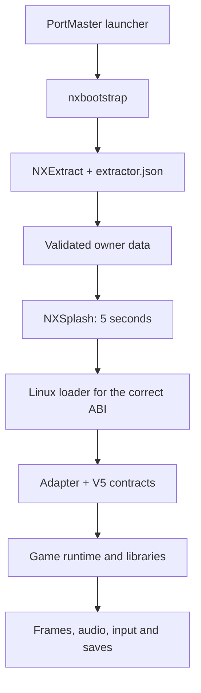

[English](../en/ARCHITECTURE.md) · [Português](../pt-BR/ARQUITETURA.md) · [中文](../../README.zh-CN.md)

# 架构与限制

框架负责组织环境探测、安装、加载、兼容性与交付。每个游戏的适配器把这些契约连接到真实引擎。它不会自动把任何 APK 变成 Linux 程序。

## 执行路径

NXExtract 在游戏启动之前准备好原作者数据。NXSplash 是另一块更晚出现的画面，用于展示 NEXT OS / RETRO ELITE 五秒钟。两者都保留各自的规范接口。生成的启动器负责控制实例与退出；渲染函数不得创建第二个窗口或进程所有者。

## 组件职责

| 领域 | 组件 | 移植职责 |
| --- | --- | --- |
| 入口与执行 | `nxbootstrap` | 声明正确的文件、ABI 与适配器 |
| 环境 | `nxcompat` | 依据实测能力与目标上限做决策 |
| 加载 | `nxloader`、`nxabi` | 库、原生顺序、导入与 ABI 桥接 |
| Android | `nxandroid` | 按构建区分的 JNI 类/方法与生命周期 |
| 图形 | `nxgl` | 引擎渲染、着色器、纹理与真实上下文的 present |
| 声音 | `nxaudio` | 游戏所用的混音器与 OpenSL/AudioTrack/AAudio 回调 |
| 输入 | `nxinput` | 真实的引擎动作与消费者；菜单/玩法 |
| 数据 | NXExtract | 身份、提取、钩子与校验配方 |
| 诊断 | `nxobs`、`nxdoctor`、`nxledger` | 执行证据与范围恰当的结论 |
| 组合 | `nxgenerator`、`nxrelease` | 清单、pin、对应源码与可验证的包 |

这些组件是集成点，而非每个 Android 服务的完整实现。特别是 `nxandroid` 并不是一个 JVM。一个被要求却缺失的方法，仍属于适配器的任务。

## ABI、操作系统与渲染器是彼此独立的决策

`arm64-v8a` 描述的是 Android 客机；AArch64 也能执行使用 glibc 的 Linux 主机，但 Bionic 与 glibc 并非在所有布局和契约上都一致。抽取器辅助工具支持 x86，并不意味着在 x86 上模拟 ARM 游戏。

同样地，一个被转译的逻辑 GLES3 渲染器，只能对真正实现了的操作使用物理 GLES2。不要宣传并不存在的扩展。在 Mali-450 上，要测量物理上下文、已编译的程序与被呈现的像素。[Unity 指南](../../portando_unity/README.en.md) 按构建逐条整理这些边界。

## 源码、包与数据

`framework/` 与 NXExtract 树是冻结的导出。`ports/*/upstream/` 含有带自身哈希的源码选集；原始构建所需的部分文件已被省略。外层参考卡片与 `SOURCE-MAP.json` 说明了该选集。这 44 个条目是参考对象，而不是本集合中 44 个已批准的安装。

新的移植必须区分原始源码、准备工具、可再分发的运行时与原作者的私有数据。抽取配方必须能从兼容的本地副本重建已准备好的数据。一个先前已抽取的目录并不能替代该证明。

## V5 身份

来源：标签 `framework-v5`，commit `657fb65a23b5c3b20040e76307b27e6470b1d17c`。[导出文件清单](../../publication/v5-export.json)。版本由组件的 `VERSION` 文件确立；历史 README 可能在同一页面上描述更早的版本。

十二个带私有依赖的测试被排除在外。不要在期待完整环境的前提下运行整个历史测试套件。本仓库未接收私有 monorepository 的历史。共享行为的变更遵循独立的 V6 路线；新的指南与示例不会改动既有移植的 pin。

继续阅读 [AI 移植](AI-PORTING.md)、[Mono Android](MONO-ANDROID.md)、[Godot](GODOT.md) 或 [Cocos2d-x](COCOS2D-X.md)。
