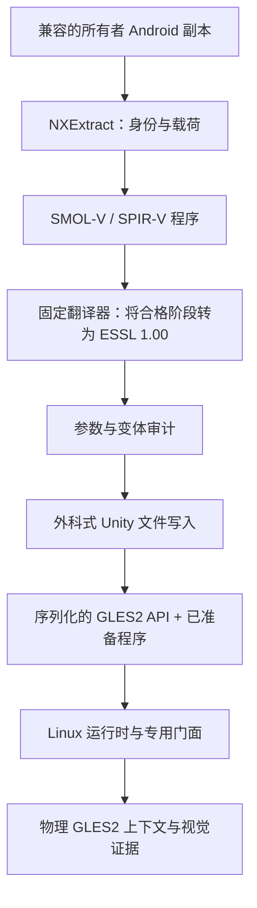

# Freedom Planet 2：从 Vulkan 程序到 GLES2

[English](../en/FP2-VULKAN-GLES2.md) · [Português](../pt-BR/FP2-VULKAN-GLES2.md) · [中文](#)

[可执行原创实验室](../../examples/zh/shader-lab/README.md)演示了 SMOL-V/SPIR-V → ESSL 1.00 以及对计算着色器的拒绝。它说明恢复了哪些公开依赖，以及为何其 SPIRV-Cross 固定版本不能替代 FP2 仍未被定位的历史固定版本。

Freedom Planet 2 单列一条技术线，因为受检的 Android 构建（Unity 2018.4.36f1/IL2CPP AArch64）声明使用 Vulkan，并含有 SMOL-V/SPIR-V 程序。NextOS 端口在装上所有者副本的同时为 GLES2 准备必需程序。这适配的是一个特定构建，不是无限制的 Vulkan API 支持。

## 1. 转换了什么

[选定的公开 README](../../ports/fp2-nextos/upstream/README.md) 描述了 31 个被修改的 Unity 逻辑文件与 2,736 条已安装的 GLES2 程序记录。通用路线保留原始纹理集，它不是一次通用的美术重烘焙。这些数字只属于该文档所记载的配置，不能当作其他 APK 的有效目标。

数据准备与运行时调用转换解决的是不同的分界。只改 API 字段不会把 SPIR-V 变成 ESSL；单独翻译着色器文本也不会实现运行时所需的 FBO、采样器或格式。

## 2. AI 应先读哪些文件

| 文件 | 作用 |
| --- | --- |
| [audit_exact_gles2.py](../../ports/fp2-nextos/upstream/tools/audit_exact_gles2.py) | 清单条目、Vulkan 上下文、转换与程序校验 |
| [inject_exact_gles2.py](../../ports/fp2-nextos/upstream/tools/inject_exact_gles2.py) | 选择、合格转换、变体策略与窄范围模板缓冲修复 |
| [serialized_patch.py](../../ports/fp2-nextos/upstream/tools/serialized_patch.py) | 保留未被触碰对象的布局/字节 |
| [gles3.c](../../ports/fp2-nextos/upstream/src/gles3.c) | 适配物理上下文的逻辑 GLES 分界 |
| [unity6_shader.c](../../ports/fp2-nextos/upstream/src/unity6_shader.c) | 程序处理支持；文件名不代表 Unity 版本 |
| [SOURCE-MAP.json](../../ports/fp2-nextos/SOURCE-MAP.json) | 公开入选版本的精确提交与哈希 |

脚本依赖 UnityPy/LZ4 以及外部翻译/校验工具。执行前请阅读配方参数与版本。未经核对序列化是否仍然一致，不要对这些库做自动升级。

## 3. 保留数据结构

管线必须能识别序列化对象、程序条目、阶段、属性、uniform、采样器与文件关系。通用容器重写可能改变未被选中的对象或 `.splitN` 分片，即便本意只想改着色器。

请使用配方中的外科式写入以匹配正确的序列化版本。比对未触碰对象的哈希/范围、大小与外部引用；用兼容的读取器重新打开结果。此操作属于 NXExtract 暂存阶段，失败时必须回滚而不能破坏既有数据。

## 4. 只转换已定义的契约

代码中的 `SKIPPED_VARIANT_POLICY`：无法用 GLES2 表达的延迟、MRT、深度、地形或 VR 变体，在已接受的配置中有明确的计数/排除项。这不授权静默丢弃另一个游戏正在使用的着色器。

对于新构建，要清点每一条目并确定执行需要哪些程序。新的转换失败必须中止准备工序，或明确标注为不受支持，而不是塞一个“能编译”的通用着色器。保留绑定、坐标约定、精度与顶点/片元接口。

## 5. “2” 的字形与模板缓冲问题

`Sprites/StencilDraw` 与 `Sprites/StencilInvert` 共用一个程序，其中带有 `yzwx` 通道旋转，这是为 Vulkan 图像视图设计的。纹理变成普通 RGBA 之后，该 swizzle 把红色转成了 alpha，透明填充因而呈现为一块彩色矩形。

修复仅限已限定标识且 SHA 预期的已转换程序。它保留正确的 RGB/alpha，需要时使用 `_AlphaTex` 并保留预乘。不要从所有名为 “Stencil” 的着色器里清除 swizzle。别的标识需要另行分析。

视觉检查包括标题的“2”、教学角色、透明边缘以及与场景的合成。比对完全相同的输入与可执行文件；一张颜色随意的标题截图并不能证明修正后的路径有效。

## 6. 第一帧之后继续测试

检查每个必需程序都已准备、编译并链接；验证场景与过渡不出现品红输出或 alpha 泄漏。保留通用路线中已记载的纹理集。然后测试音频、输入、教学关、后续加载、存档/读档与退出。

公开源码还记录了一处 Bionic 信号量生成修复：能正确渲染并不排除之后出现加载卡死。不要因为一个故障最初表现为 Vulkan，就把所有 FP2 问题都归给着色器。

## 7. 复用方法

可迁移的部分是方法本身：精确清单、只转合格项、数据保全、明确的不兼容策略、窄范围的已识别修复与实机证据。不要把 FP2 的数量、偏移量或例外复制到另一个游戏中。

请查阅[许可范围](../../LICENSING.en.md)：仓库中的 MIT 识别并不意味着每个 loader/hook/GLES 组件都是 MIT。端口代码归 NextOS，并保留第三方署名。原始着色器/资源仍属所有者数据，不收录于本集合。
